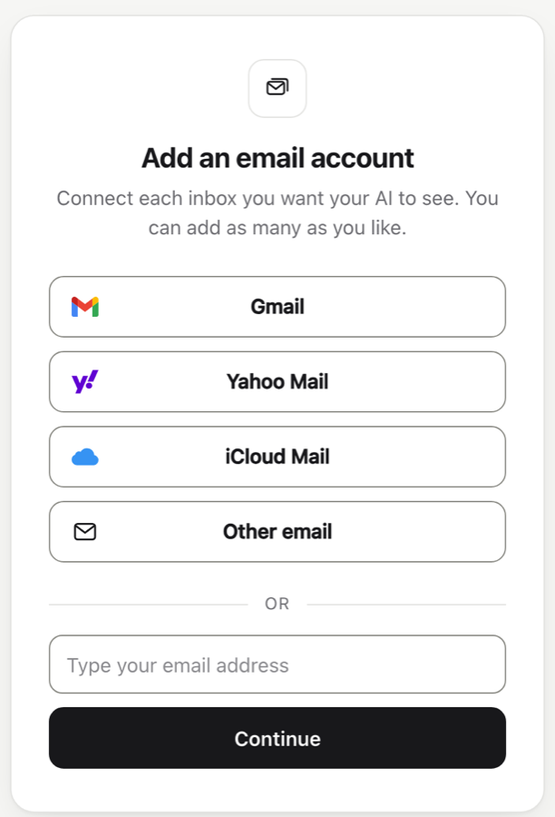

# multi-account-mcp

Connect all of your email accounts to your AI tool at once. multi-account-mcp is a local [MCP](https://modelcontextprotocol.io) server that lets Claude, Cursor and other AI tools search, read and draft across every inbox you have, with each message labeled by the account it came from.

[](https://github.com/Soe-Reh/multi-account-mcp/actions/workflows/ci.yml)
[](https://www.npmjs.com/package/multi-account-mcp)
[](LICENSE)


Many people have more than one email address, often with different providers. AI email connectors usually handle one account at a time. This one connects them all, so a single question covers every inbox.

For example, someone with three accounts, named School, Jobs and Personal:

```
You:     Check all my inboxes and tell me what actually matters.

Claude:  School (you.school@gmail.com)
         - Your professor posted an announcement: Friday's lecture is moving online.
         - Problem set 4 is due tomorrow at 11:59 PM.
         Jobs (you@yahoo.com)
         - A recruiter asked for your availability for a first-round interview.
         - One of your applications closes today.
         Personal (you@gmail.com)
         - Your tickets for Saturday's concert are ready.
         - Google flagged a new sign-in to your account.

         Skipped 40 promotions and newsletters.
```

You choose the account names, and any mix of providers works. Your AI tool writes the reply; multi-account-mcp gives it access to the mail.

## Features

- Search every account in one call, or only the ones you choose
- Open attachments: PDF, Word and Excel files as text, photos and scanned pages as images
- Write drafts from the right account, and send them only when you allow it
- Add accounts from a sign-in page on your own computer, with server settings found for you
- Logins stored in your system keychain, never in a config file
- Runs locally, with no server in between and nothing collected

## Quick start

Requires Node.js 20.19 or newer.

```sh
npx -y multi-account-mcp install claude-desktop   # or claude-code, cursor
npx -y multi-account-mcp add                      # opens the sign-in page
```

Restart your AI tool, then ask what's new across your inboxes.



| Provider | How you sign in |
|---|---|
| Gmail | An app password, or Continue with Google when a Google client is configured |
| Yahoo | An app password |
| iCloud | An app-specific password from Apple |
| Any other provider | "Other email", with the password your provider gives for mail apps |

Step-by-step instructions for each provider are in [docs/accounts.md](docs/accounts.md). Setup for other AI tools (VS Code, Gemini CLI, Codex) and uninstall steps are in [docs/install.md](docs/install.md).

<details>
<summary>Claude Code plugin</summary>

The plugin installs the server and adds a `check-in` skill that goes through all your accounts and lists what needs a reply.

```
/plugin marketplace add Soe-Reh/multi-account-mcp
/plugin install multi-account-mcp@multi-account-mcp
```

</details>

<details>
<summary>Run from source</summary>

```sh
git clone https://github.com/Soe-Reh/multi-account-mcp.git
cd multi-account-mcp
npm install
npm run build
node dist/cli/index.js install claude-desktop
node dist/cli/index.js add
```

`install` saves the path to this folder in your AI tool's settings, so keep the folder where it is. Use `node dist/cli/index.js` wherever this page says `npx -y multi-account-mcp`.

</details>

## Example prompts

- "Give me a digest of all my inboxes: what needs a reply, what has a deadline, what I can skip."
- "What came in across all my accounts since yesterday?"
- "Find the email with my lease and read the PDF, whichever account it's in."
- "Who's waiting on a reply from me in any inbox?"

## Tools

| Tool | Description |
|---|---|
| `list_accounts` | Lists your accounts and whether sending is on for each |
| `search_mail` | Searches every account at once, or only the ones you name. With no search words, returns recent mail |
| `read_message` | Opens one message, with its text and a numbered list of attachments |
| `read_attachment` | Opens an attachment: PDF, Word and Excel as text; scanned PDFs and photos as images; text files and calendar invites as text |
| `create_draft` | Saves a draft in the account you choose. Nothing is sent |
| `send_draft` | Sends a draft, only from an account where sending is turned on |

If one account can't be reached, the others still answer, and the result names the account that failed and why.

## Privacy and security

multi-account-mcp runs on your computer and talks only to your mail providers. Passwords and sign-in tokens are stored in your system keychain (Keychain on macOS, Credential Manager on Windows, Secret Service on Linux). The account list in `~/.multi-account-mcp/accounts.json` contains names and addresses only.

Your AI tool sees the mail it reads. If the tool runs in the cloud, that mail is handled under the tool's own privacy policy.

Sending is off for every account until you turn it on:

```sh
npx -y multi-account-mcp allow-send <account>
npx -y multi-account-mcp allow-send <account> --off
```

Once it's on, every send shows you the sender, recipients, subject and the start of the message, and waits for your approval. Claude Code shows this prompt. Claude Desktop doesn't show it reliably, so there sending is refused unless you run `allow-send <account> --no-confirm`, which lets the AI send from that account without asking.

Email can contain text written to trick an AI. All email and attachment content is passed to the AI marked as untrusted, with instructions not to act on it, and hidden characters are removed. Still read each send prompt before approving it.

See [PRIVACY.md](PRIVACY.md) and [SECURITY.md](SECURITY.md) for details.

## Commands

Run each as `npx -y multi-account-mcp <command>`. `<account>` can be an account's id, name or email address.

```
install <client>       Add the server to claude-code, claude-desktop or cursor (--print for vscode, gemini-cli, codex)
add                    Open the sign-in page to add accounts (--no-open prints the address instead)
list                   Show your accounts
test [account]         Check that one or all accounts can sign in
remove <account>       Remove an account and its saved login (--yes skips the question)
allow-send <account>   Turn sending on for an account (--off, --no-confirm, --yes)
serve                  Run the server (your AI tool does this for you)
```

## Limitations

- Outlook.com and Hotmail are not supported yet. Microsoft requires its own sign-in for them.
- Scanned PDFs show their first 3 pages. Zip files and older Office formats (.doc, .xls) can't be opened.
- Folders can be searched by name, but not listed. Mail can't be moved or deleted.
- ChatGPT only connects to hosted servers, so it isn't supported.
- Developed and tested on macOS. Windows and Linux are less tested.

Having trouble? See [docs/troubleshooting.md](docs/troubleshooting.md).

## Contributing

Bug reports and pull requests are welcome. See [CONTRIBUTING.md](CONTRIBUTING.md) for setup and [docs/testing.md](docs/testing.md) for how the tests work.

## License

[MIT](LICENSE)
